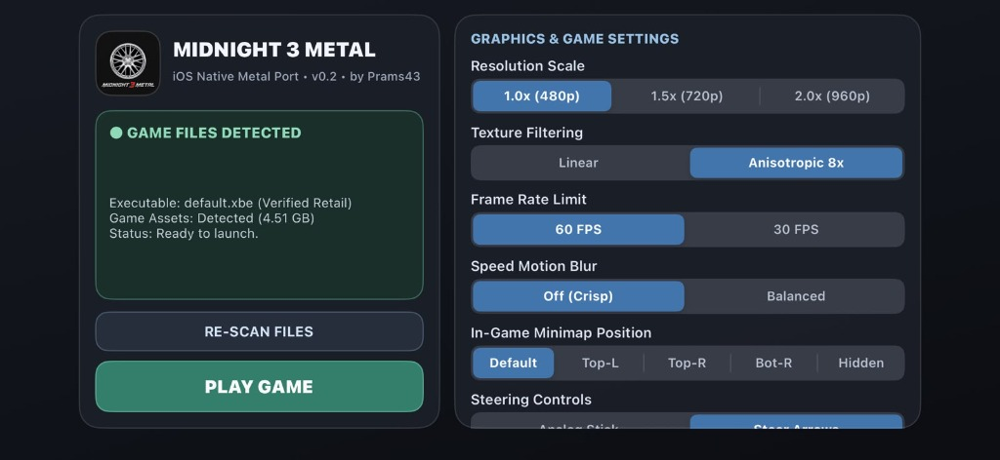
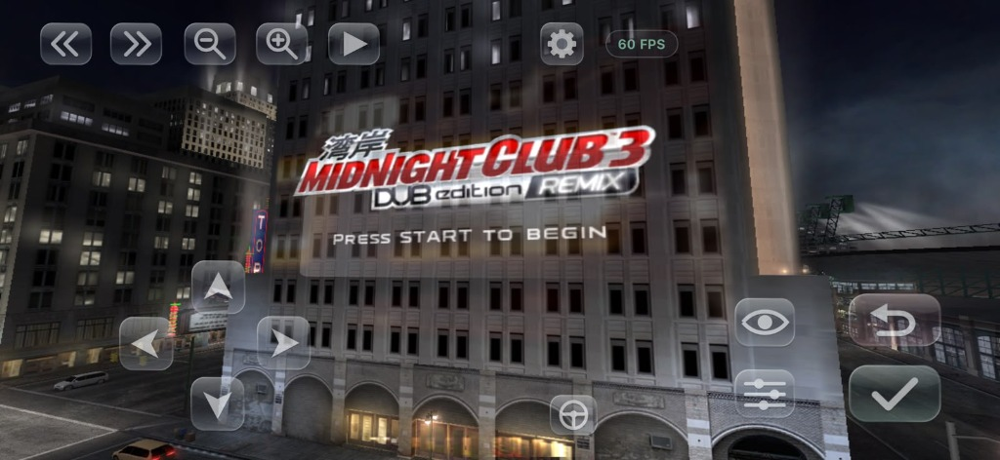
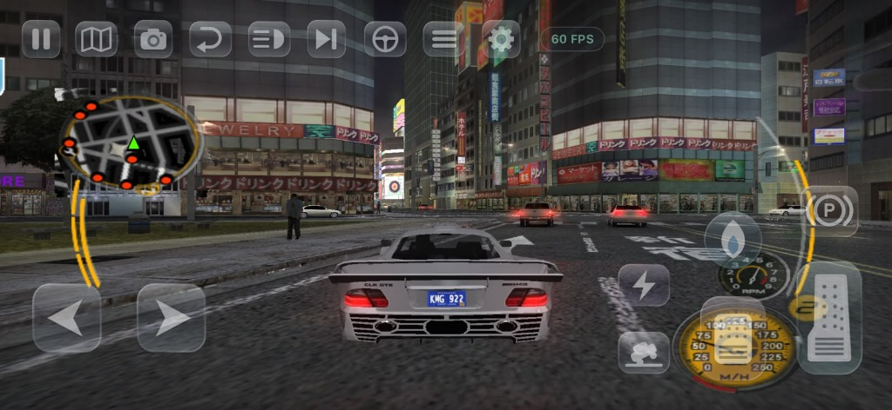
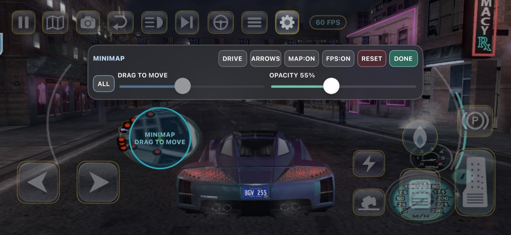
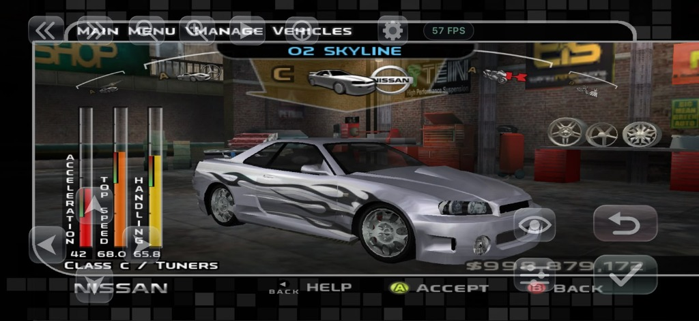
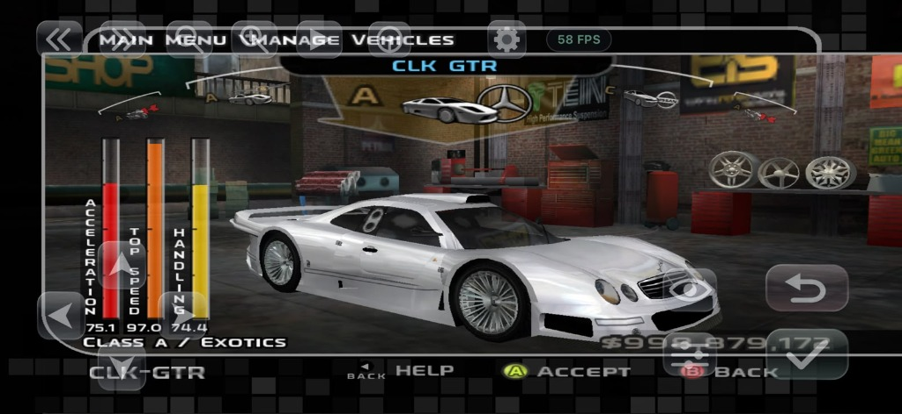

<p align="center">
  
</p>

<h1 align="center">Midnight3Metal</h1>

<p align="center">
  <strong>Native iOS (ARM64 / Metal) Static Recompilation Port of Midnight Club 3: DUB Edition Remix</strong>
</p>

<p align="center">
  
  
  
  
  
  <br />
  
  
  
  
  
  
</p>

**Midnight3Metal** is a native **iOS (ARM64 / Apple Metal)** static recompilation port of the original Xbox **Midnight Club 3: DUB Edition Remix**, developed by **Prams43**.

Instead of running an x86 CPU emulator or requiring JIT, the original Xbox executable (`default.xbe`) is statically recompiled ahead of time into portable C++ and linked against a native iOS runtime powered by **Apple Metal**, **Audio Queue Services**, and **UIKit** touch & controller input — delivering smooth **50–60 FPS** gameplay natively on iPhone and iPad with **no jailbreak and no JIT**.

> **Disclaimer:** This repository contains **source code, runtime libraries, and build configuration only**. No copyrighted game binaries (`default.xbe`), assets, textures, audio, or Xbox SDK files are included. You must supply your own legally obtained original Xbox copy of *Midnight Club 3: DUB Edition Remix*.

---

## Screenshots

<table>
  <tr>
    <td align="center" width="50%">
      
      <br />
      <sub><strong>Pre-Launch Setup &amp; File Verification</strong> — Live asset check &amp; graphics/HUD settings</sub>
    </td>
    <td align="center" width="50%">
      
      <br />
      <sub><strong>Title Screen (60 FPS)</strong> — Native 3D frontend &amp; Liquid Glass menu controls</sub>
    </td>
  </tr>
  <tr>
    <td align="center" width="50%">
      
      <br />
      <sub><strong>Tokyo Open-World Driving (60 FPS)</strong> — CLK GTR with Liquid Glass HUD &amp; custom minimap</sub>
    </td>
    <td align="center" width="50%">
      
      <br />
      <sub><strong>In-Game HUD &amp; Minimap Editor (⚙)</strong> — Drag, resize &amp; adjust opacity live in-game</sub>
    </td>
  </tr>
  <tr>
    <td align="center" width="50%">
      
      <br />
      <sub><strong>Garage Customization</strong> — Full 3D vehicle viewer ('02 Skyline) &amp; auto Menu HUD</sub>
    </td>
    <td align="center" width="50%">
      
      <br />
      <sub><strong>Manage Vehicles (58 FPS)</strong> — Class A Exotics (CLK GTR) in 128 MB guest RAM mode</sub>
    </td>
  </tr>
</table>

---

## Current Status & Compatibility

| Subsystem | Status | Notes |
| :--- | :---: | :--- |
| **Native ARM64 Execution (No JIT)** | ✅ Working | Ahead-of-time static recompilation; runs on stock iOS 13.0+ devices |
| **Open-World Cities & Career / Tokyo Challenge** | ✅ Working | San Diego, Atlanta, Detroit, and Tokyo fully playable at up to **60 FPS** |
| **Metal 3D Rendering & Shaders** | ✅ Working | NV2A fixed-function, vertex shaders, pixel combiners, P8 palettes, cube maps, depth-bias anti-Z-fighting |
| **Garage & Car Customization** | ✅ Working | 128 MB guest memory mode expands the game heap (47 MB → 111 MB) to prevent Garage OOM crashes |
| **Audio (Music + 3D Vehicle SFX)** | ✅ Working | 48 kHz DirectSound/XACT mixer on Audio Queue Services; smooth track skipping & 3D engine/NOS/crash SFX |
| **Bink FMV Cutscenes** | ✅ Working | Intro & career Bink movies decoded and rendered natively |
| **Touch Controls & HUD/Minimap Editor** | ✅ Working | iOS Liquid Glass icons, Steer Arrows / Analog Stick, draggable & resizable buttons and in-game minimap |
| **Bluetooth / MFi / Xbox / PS Gamepads** | ✅ Working | Native controller input via SDL3 / iOS GameController |
| **Save Data & Profiles** | ✅ Working | Persisted in `MC3 Remix/save/E/UDATA/54540079/` |
| **Xbox Live / Online Multiplayer** | ⛔ Offline | Stubbed cleanly so single-player career, arcade, and garage work without errors |

### Known Notes
- **First-time shader compilation:** The first time a new city, vehicle shader, or visual effect appears in a session, Apple Metal compiles its MSL pipeline state on demand, which can cause brief one-time micro-stutters before smoothing out to 50–60 FPS.
- **Imported Xbox saves:** Retail Xbox saves downloaded from the internet must be re-signed for the runtime's zeroed `XboxSignatureKey` (`HMAC-SHA1` over the trailing 20 bytes of `.mc3Remix` files) to avoid a *"damaged game"* message.

---

## Key Features

- **Native Apple Metal Renderer (`sdk/runtime/gpu/metal.mm`)**
  - Translates NV2A fixed-function pipelines, programmable vertex shaders, and Xbox pixel combiners directly to Metal Shading Language (MSL).
  - Supports offscreen render targets, feedback copies, viewport/scissor clipping, masked/sub-rect clears, NV2A polygon offset / depth-bias (eliminating road Z-fighting), backface culling, P8 paletted textures, cube/3D textures, and Bink video decoding.
  - Triple-buffered transient upload ring buffer (`MTLBuffer`), zero-copy vertex layouts, and per-encoder state caching for high frame rates without sacrificing visual quality.
  - Configurable **Resolution Scale** (`1.0x 480p` / `1.5x 720p` / `2.0x 960p`), **Anisotropic 8x Filtering**, **Frame Rate Cap** (`60` / `30 FPS`), and **Balanced Peripheral Motion Blur**.
- **Xbox DirectSound & XACT Software Mixer (`sdk/runtime/xdk/dsound.cpp`)**
  - Full HLE DirectSound buffer and stream mixer on Apple Audio Queue Services (`48 kHz` stereo float) with Xbox ADPCM/PCM decoding, 3D surround-to-stereo downmix, submix pitch bending (engine RPM), envelopes, and clean async `FlushEx` stream lifecycles.
- **Pre-Launch Setup & File Integrity Screen (`ios-app/ViewController.mm`)**
  - Soft dark-graphite launcher that scans your `Documents` folder for `default.xbe` and game assets (`GAME FILES DETECTED` / `NOT DETECTED` with live **Re-Scan**) before starting the game.
  - Lets you configure resolution, filtering, FPS cap, motion blur, minimap position, steering mode, FPS overlay, and audio before entering the game.
- **iOS Liquid Glass Touch HUD & Live Minimap Editor (`sdk/runtime/app/ios_touch_controls.mm`)**
  - Custom translucent **iOS Liquid Glass** button icon set (gas/brake pedals, analog stick / steer arrows, handbrake, nitro, special ability, camera, look back, headlights, next track, pause, map, and menu controls).
  - Auto-switches between **Driving** and **Menu / Garage** control layouts (with manual override).
  - Tap **`⚙`** in-game to open the frosted-glass **HUD Editor** — drag any touch button **or the in-game Xbox minimap** anywhere on screen, resize individual buttons or scale the entire HUD, adjust opacity, toggle minimap/FPS visibility, and save your layout across sessions.
- **Automated CI iOS IPA Build (`.github/workflows/ios-build.yml`)**
  - Compiles an unsigned ARM64 Release `.ipa` on `macos-15` via Xcode.

---

## Requirements & Installation on iOS

No jailbreak and **no JIT** are required.

### Requirements
- **Device:** iPhone or iPad with ARM64 Apple Silicon (iOS / iPadOS **13.0+**, 60 FPS recommended on A12 / iPhone XS or newer).
- **Game Copy:** Your own legally obtained original Xbox copy of **Midnight Club 3: DUB Edition Remix** (`default.xbe` + extracted game asset folders, ~4.5 GB).
- **Sideloading Tool:** AltStore, SideStore, Sideloadly, TrollStore, Feather, or Xcode.

### Step-by-Step Setup
1. **Download the `.ipa`** from the [Releases](https://github.com/Prams43/Midnight3Metal/releases/latest) page (or build it yourself with Xcode / `.github/workflows/ios-build.yml`).
2. **Sign & install** the `.ipa` onto your iPhone or iPad using your preferred sideloading tool.
3. **Copy your game files** into the app's `Documents` folder:
   - Open the iOS **Files** app → **On My iPhone** (or **On My iPad**) → **`MC3 Remix`** *(or transfer via Finder / iTunes File Sharing over USB)*.
   - Place **`default.xbe`** and all extracted Xbox game folders directly inside **`MC3 Remix/`**:
     ```text
     On My iPhone/MC3 Remix/
     ├── default.xbe
     ├── assets_x.dat          (and all other extracted Xbox game files/folders)
     ├── ...
     └── save/                 (created automatically by the app)
         └── E/UDATA/54540079/ (your Xbox profile & career saves)
     ```
4. **Launch `MC3 Remix`** in landscape orientation:
   - Confirm the launcher shows **`GAME FILES DETECTED`** in green.
   - Choose your preferred Resolution Scale (`1.0x` / `1.5x` / `2.0x`), Texture Filtering, Frame Rate Limit, Motion Blur, and Steering style, then tap **`PLAY GAME`**.

---

## Controls

- **Touch Controls (Liquid Glass HUD):**
  - Automatically switches between **Driving** (gas, brake/reverse, handbrake, nitro, special/zone, steer arrows or analog stick, pause, map, camera, look back, headlights, next track) and **Menu / Garage** (D-pad, accept, back, view, sliders).
  - Tap **`⚙`** in the top bar at any time to drag/resize buttons and reposition the in-game minimap.
- **Physical Controllers:**
  - Connect any **Bluetooth / MFi / Xbox / PlayStation** controller for full native analog steering, triggers, and menu navigation.

---

## Repository Structure

```text
.
├── config/                 # Recompiler configuration & Xbox XDK 5849 symbol maps (game.toml)
├── docs/screenshots/       # Showcase screenshots for README
├── ios-app/                # iOS UIKit + CAMetalLayer host app, Info.plist, Liquid Glass icons
├── ios-game-runtime/       # Lightweight iOS SDK compile-check target for core runtime modules
├── sdk/
│   ├── runtime/
│   │   ├── app/            # iOS Liquid Glass touch HUD & minimap editor (ios_touch_controls.mm)
│   │   ├── audio/          # Apple AudioQueue backend (audio_apple.mm) & XAudio2 backend
│   │   ├── core/           # Input abstraction, logging, hitch profiler
│   │   ├── cpu/            # x86 execution context & static dispatch tables
│   │   ├── gpu/            # NV2A/D3D8 state, vertex assembler, HLSL->MSL translator, Metal backend
│   │   ├── kernel/         # Xbox kernel HLE (threads, timers, DPC/APC, 128 MB VM, VFS)
│   │   └── xdk/            # DirectSound/XACT, XAPI/XInput, XNet/XOnline HLE modules
│   └── xdk/                # XDK 5849 struct layouts and signature definitions
├── src/                    # Game-specific hooks, patches, and career/traffic bridges
├── tools/                  # Repository cleanliness guard & helper scripts
└── .github/workflows/      # GitHub Actions CI workflow for iOS IPA builds
```

---

## Development & Repo Hygiene

Before committing changes, run the repository cleanliness check to verify that no game assets, build outputs, or temporary files are tracked:

```bash
python tools/check_repo_clean.py
```

---

## Credits, License & Legal

- **iOS Metal Port, Liquid Glass HUD & Launcher:** [Prams43](https://github.com/Prams43)
- **Upstream Static Recompilation Runtime & Xbox XDK SDK:** Built upon the open-source Xbox XBE Recomp / `mc3port` ecosystem (see [NOTICE.md](NOTICE.md) and [sdk/THIRD_PARTY.txt](sdk/THIRD_PARTY.txt)).
- **License:**
  - The iOS port and project code in this repository are licensed under the **GNU General Public License v3.0** — see [LICENSE](LICENSE).
  - The modified Xbox XBE Recomp SDK under `sdk/` retains its original **MIT License** — see [sdk/LICENSE](sdk/LICENSE) and [NOTICE.md](NOTICE.md).
- **Legal:** This project is intended for preservation, research, and educational purposes. *Midnight Club 3: DUB Edition Remix* is a trademark of Rockstar Games / Take-Two Interactive. Original Xbox and DirectSound/XACT are trademarks of Microsoft Corporation.
